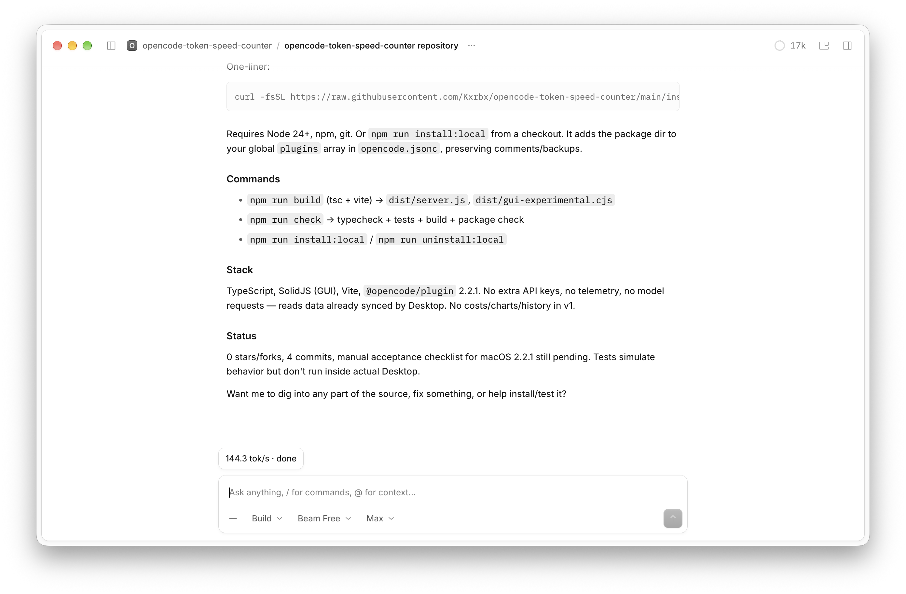

# Token Speed Counter for OpenCode Desktop

A live tokens-per-second counter for **OpenCode Desktop 2.2.1 and later**, targeting **macOS**. A pill above the composer shows the speed of the latest model request:

- During generation: `≈ 42.3 tok/s · Generating`.
- After completion: `38.7 tok/s · done`.
- Click the pill for output tokens, reasoning tokens, total tokens, duration, model, and measurement source.

The interface follows OpenCode’s language and native components, with English and French localization and support for light and dark themes. The extension makes no additional model requests, requires no additional API keys, and adds no history or telemetry. It reads data already synchronized by Desktop.



## Quick installation on macOS

Requires **OpenCode Desktop 2.2.1 or later**, **Node.js 24+**, npm, and Git. Quit Desktop, then paste this command into Terminal:

```bash
curl -fsSL https://raw.githubusercontent.com/Kxrbx/opencode-token-speed-counter/main/install.sh | bash
```

The installer downloads the extension to `~/.local/share/opencode-token-speed-counter`, installs dependencies, builds it, and adds its absolute directory path to the global OpenCode `plugins` array. **Restart Desktop** and open a main conversation to see the pill.

The installer makes this configuration change explicitly. It preserves JSONC comments, other plugins and settings, and creates a timestamped backup before changing an existing file. Running it again updates the checkout and does not add another entry. It uses no `sudo` and does not install system prerequisites automatically.

If the repository was already cloned and built, run this from its directory:

```bash
npm run install:local
```

To inspect the installer before running it, open [`install.sh`](install.sh) and [`scripts/configure.mjs`](scripts/configure.mjs). For help from an existing checkout, run `bash install.sh --help`.

Custom locations are supported through `TOKEN_SPEED_INSTALL_DIR`, `XDG_DATA_HOME`, and `XDG_CONFIG_HOME`. The installer stops instead of overwriting an unrelated directory or a checkout with local changes. If both `opencode.json` and `opencode.jsonc` exist, or `OPENCODE_CONFIG`, `OPENCODE_CONFIG_DIR`, or `OPENCODE_CONFIG_CONTENT` is used, use the manual method below to select the intended configuration. Only the global configuration is changed; remove any existing project-level declaration of this extension to avoid duplicates across configuration files.

## Manual installation on macOS

### 1. Prerequisites

- OpenCode **Desktop 2.2.1 or later** (check the About dialog). The GUI API is experimental; versions older than 2.2.1 are not supported.
- Node.js **24 LTS**, npm, and Git. Check them in Terminal:

```bash
node --version
npm --version
git --version
```

Version 1 installs from a locally compiled directory. No npm publication or Desktop application changes are required. Keep this directory in place after activation.

### 2. Download and build

From a permanent location of choice:

```bash
git clone https://github.com/Kxrbx/opencode-token-speed-counter.git
cd opencode-token-speed-counter
npm ci
npm run build
```

If the directory already exists, follow the update instructions below instead of cloning again.

The build must produce at least:

```text
dist/server.js
dist/gui-experimental.cjs
```

Print the absolute path to use in the configuration:

```bash
pwd -P
```

Do not use a cloud workspace path such as `/workspace/...` on a Mac.

### 3. Enable globally (recommended)

Quit OpenCode Desktop completely (`⌘Q`). In the OpenCode user configuration, add the absolute path to the **package directory**, rather than a JavaScript file, to the `plugins` array.

The standard location is `~/.config/opencode/opencode.jsonc` (or an existing `opencode.json`). If `XDG_CONFIG_HOME` was customized, use its `opencode` subdirectory. Edit the existing file rather than creating a second, competing configuration.

Back up the existing file before editing it. For example, only if this file is used:

```bash
cp -p ~/.config/opencode/opencode.jsonc ~/.config/opencode/opencode.jsonc.backup-$(date +%Y%m%d-%H%M%S)
```

Merge this minimal example into the configuration, replacing the path with the output of `pwd -P`:

```jsonc
{
  "$schema": "https://opencode.ai/config.json",
  "plugins": [
    "/Users/YOUR_NAME/Extensions/opencode-token-speed-counter"
  ]
}
```

Preserve all other plugins and settings. If `plugins` already exists, add a single entry, separated by a comma. If this path is already listed, add nothing. In 2.2.1, the field is **`plugins`, plural**. Use an absolute path without `~` or shell variables inside the JSON.

### Alternative: enable for one project

After backing up the project’s `opencode.jsonc` (or existing `opencode.json`), add the same entry to its `plugins` array, then open that project in Desktop. Choose this method **or** the global installation to avoid duplicate declarations. Do not share a personal absolute path as common project configuration.

### 4. Verify in Desktop

1. Restart OpenCode Desktop and open a project and a main conversation.
2. Verify that `token-speed-counter` is active under **Extensions → Plugins**. If needed, open a project using the relevant configuration and restart Desktop.
3. Send a prompt that generates a response lasting a few seconds.
4. Check the pill near the composer, then click it to open the details.
5. At completion, check the final result: it uses provider counters when available; otherwise, it keeps the `≈` symbol.

OpenCode does not show pills from this extension point in subagent conversations. Version 1 targets main conversations.

The extension does not edit configuration while running. Only the explicit installer or `npm run install:local` changes the configuration. With manual activation, check the existing entry instead of adding it again.

## Updating

For a quick installation, quit Desktop and rerun the one-command installer above. For a manual installation, run these commands in the extension directory:

```bash
git pull --ff-only
npm ci
npm run build
```

Restart Desktop. The configured path stays the same; do not add another entry. If Git reports local changes or diverging branches, preserve them and resolve the issue before continuing; do not blindly reset the repository. Check compatibility notes before updating OpenCode itself.

## Disabling and uninstalling

To hide the counter temporarily, disable its GUI component under **Extensions → Plugins**. The counter’s server entry adds no generation hooks.

If the quick installer was used, quit Desktop and remove its configuration entry with:

```bash
cd "$HOME/.local/share/opencode-token-speed-counter"
npm run uninstall:local
```

Use a chosen directory instead if the installation path was customized. This command backs up the existing configuration and removes only entries matching this extension directory. It preserves other settings and can be repeated safely. Restart Desktop afterward. The directory may then be deleted if desired.

To uninstall manually:

1. Quit Desktop.
2. Remove only this extension’s path from `plugins` in the configuration chosen during installation. Keep the other entries and adjust commas if needed.
3. Restart Desktop and verify that the pill is gone and other plugins still work.
4. Optionally delete the local extension directory.

No keys, provider data, or conversations are deleted. The running extension creates no persistent measurement data to clean up. Installer backups remain beside the configuration file; keep or delete them as appropriate. If the entry is already absent, no configuration change is needed.

## Understanding the numbers

### Final average

```text
(tokens.output + tokens.reasoning) / ((time.streamed - time.created) / 1000)
```

OpenCode 2.2.1 provides these token categories separately. The duration includes the wait before the first token and ends when the provider stream finishes, **before tool settlement**. It therefore measures request throughput, rather than only the generation speed after the first token. Input and cache tokens are not included.

A new request after a tool call starts a new measurement. The counter does not combine requests within a turn or include subagents. While a tool runs, the previous request’s result stays frozen. Results are reconstructed from synchronized messages after a restart, without the extension maintaining its own history.

### During generation

The estimate counts Unicode characters in the received text and reasoning, divides by **4**, then divides by the time elapsed since the request was created. It refreshes every **250 ms**, only during an active request in the displayed conversation.

Estimates **always keep the `≈` symbol**. This is not a model-specific tokenizer: accuracy varies by language, code, and model. Hidden reasoning and tool arguments cannot be estimated from displayed text. The final result may therefore change substantially when actual counters arrive.

If a local endpoint or provider does not report counters, the final average remains estimated. A missing, zero, or inconsistent duration displays `Unavailable` instead of a misleading rate. An interrupted request without a stream-end timestamp receives no invented final average. A disconnection suspends the live rate; reconnection resumes using the server’s data.

## Troubleshooting

| Symptom | What to check |
| --- | --- |
| No pill | Open a main conversation; check the project, `plugins`, the absolute directory path, and GUI activation, then restart Desktop. |
| Loading error | Check `dist/server.js` and `dist/gui-experimental.cjs`; rerun `npm ci` and `npm run build`. Do not move the directory after activation. |
| `Unavailable` after an update | The installed OpenCode version is older than 2.2.1. The pill’s menu reports the detected version. |
| `≈` remains after completion | Final counters are missing or invalid. This is expected for some endpoints; no additional key is needed for the counter. |
| Reasoning is underestimated live | The provider may hide reasoning; only its final accounting can report it. |
| `Disconnected` | Restore OpenCode’s connection to its server; the counter reuses that connection. |
| No final average after interruption | The stream-end timestamp may be missing. Tool execution time or time since interruption is never used as a substitute. |
| Duplicate installation entry | Keep one entry, globally or per project, without changing other plugins. |

## References and limitations

- [GUI API 2.2.1: ComposerPill](https://github.com/anomalyco/opencode/blob/v2.2.1/packages/plugin/src/gui/registries.ts)
- [Official GUI build helper](https://github.com/anomalyco/opencode/blob/v2.2.1/packages/plugin/src/gui/vite.ts)
- [Official local installation example using plugins](https://github.com/anomalyco/opencode/blob/v2.2.1/packages/plugins/figma/README.md)

Version 1 includes no costs, global statistics, charts, additional history, or automatic publication. The API’s presence in 2.2.1 and successful compilation against its SDK do not guarantee compatibility with future versions.
